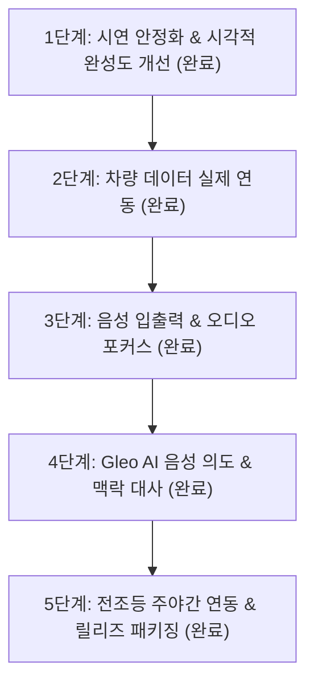

# 온길 (On-Gil) - 프로젝트 분석 및 전 단계(Phase 1~5) 완료 보고서

> **슬로건**: "도로 위를 따뜻하게" (도로 위에 마음을 남깁니다)  
> **한 줄 정의**: 안전·매너운전과 도로 위 음성 쪽지로 나만의 펫을 키우고, 적립된 포인트를 현대자동차 실질 혜택으로 전환하는 참여형 모빌리티 일상 동행 서비스  
> **타깃 플랫폼**: 현대자동차그룹 Pleos Connect (Android Automotive OS, API 34 Landscape 2560×1440)

---

## 1. 프로젝트 현황 분석

### 1.1 서비스 컨셉 및 핵심 가치
1. **0점에서부터 쌓이는 긍정 강화형 안전·매너운전**
   - 100점에서 감점하는 스트레스형 점수가 아닌, 안전하고 배려하는 운전을 할 때마다 EXP와 포인트가 누적되는 구조.
   - 현대차 브랜드 컬러(현대 블루 `#002C5F`, 샌드 `#E4DCD3`, 액티브 블루 `#00AAD2`)로 통일된 고급스러운 인카 UI.
2. **도로 위 음성 쪽지 (10초 핸즈프리 & 익명 TTS + 오디오 포커스 Ducking)**
   - 주행 중에는 텍스트 입력을 차단하고 10초 음성(STT)으로만 작성.
   - 녹음 원본은 저장·공유하지 않고, AI 안전 필터링/순화 후 완전 익명 TTS로 전달.
   - FusedLocation 방위각(Heading) 기반으로 **진행 방향 ±45° 이내 운전자에게만 재생**하여 반대 차선 혼선 방지.
   - 차량 음악·라디오 재생 중 쪽지 수신 시 `AudioFocusRequest(AUDIOFOCUS_GAIN_TRANSIENT_MAY_DUCK)`로 배경 볼륨을 부드럽게 낮춤(Ducking).
3. **애니메이션 마스코트 캐릭터 동행 (펫 '제로')**
   - 부드러운 셀 셰이딩·그라데이션, 초롱초롱한 듀얼 캐치라이트 눈망울, 살랑거리는 귀와 꼬리를 갖춘 **애니메이션 강아지 캐릭터 '제로' (`PetDog.kt`)**.
   - 성장 단계(Lv.1 기본 목걸이 → Lv.2 방울 머플러 → Lv.3 발그레한 볼터치 → Lv.4 황금 왕관)에 따른 시각적 변화.
   - 쪽지 수신 승인 시 **쪽지를 양손에 들고 경청하는 인터랙션** 및 도로·날씨·전조등 상태 맞춤형 대사(`GleoAiAssistant`) 제공.
4. **고정 시야 3D 내비게이션 (`NavMap.kt`) & 전조등 연동 주/야간 테마**
   - 주행 중 카메라 줌(`FIXED_CAMERA_ZOOM = 18.2`)과 기울기(`CAMERA_TILT = 45.0°`)를 고정하고, 3D 건물 압출 높이를 최대 `18m`로 상한 고정하여 고층 빌딩 구간이나 교차로 진입 시에도 시야가 출렁이거나 가려지지 않도록 설계.
   - `RouteWindow` 기반 슬라이딩 경로선 그라데이션 트리밍으로 차량이 지나간 경로를 실시간으로 부드럽게 소거.
   - 태양 고도(NOAA) 계산과 **차량 전조등(`Light.registerLowBeamLightState`) 점등 신호**를 결합해 야간 및 터널 진입 시 즉시 다크 지도로 자동 전환.
5. **현대자동차 생태계 혜택 연계**
   - 적립된 온기 포인트를 블루멤버스(Blue Members), 블루핸즈 정비 할인권, 마이현대 Shop 순정용품 교환권, 현대해상 UBI 안전운전 특약 할인으로 전환.

---

### 1.2 아키텍처 및 구현 완성도

| 영역 | 구현 내용 | 상태 |
|---|---|---|
| **주행 화면 (`DriveScreen`)** | • 고정 시야(`18.2` 줌, 건물 최대 `18m` 캡) 3D 내비게이션 지도 • `RouteWindow` 기반 지나간 경로선 실시간 그라데이션 트리밍 • OSRM 실제 경로 파싱 및 오프라인 데모 경로 Fallback • TBT 회전 안내 카드, 남은 시간/거리 표시 • 태양 위치 공식(NOAA) + **차량 전조등(LowBeam) 연동 주/야간 지도 자동 전환** • 주행 중 터치 차단(핸즈프리 음성 명령 승인 원칙 준수) 및 애니메이션 강아지 펫 '제로' 인터랙션 | **구현 완료** (검증 완료) |
| **정차/주차 화면 (`ParkedScreen`)** | • 기어 P 또는 정차(속도 0) 시 자동 전환되는 3-Pane 대시보드 (현대차 3색 시스템 적용) • 받은 쪽지함 & 내가 남긴 쪽지함 (`NoteInboxScreen`) • 설정 화면 (쪽지 자동 재생, 출퇴근 밴드 필터, 지도 테마 수동 선택) • 오늘의 온기 리포트 ("N명이 들었고 M명이 좋아요") • 나의 바퀴자취 지도 (익명 구간 단위 이동 경로 시각화) • 현대 모빌리티 리워드 교환소 | **구현 완료** (검증 완료) |
| **실시간 차량 신호 추적 (`VehicleSignalTracker`)** | • `Vehicle SDK` 실시간 기어(`Gear`), 방향지시등(`TurnSignal`), 브레이크(`Brake`), 누적거리(`Odometer`), 전조등(`Light`) 리스너 바인딩 • `FusedLocation` 연속 좌표 변위($\Delta d / \Delta t$) 기반 실시간 속도(km/h) 및 초당 가감속도(km/h/s) 정밀 산출 | **구현 완료** (검증 완료) |
| **안전·매너 평가 엔진 (`MannerEvaluationEngine`)** | • **Safe Drive**: 1.0km 정속 주행 시마다 +10 EXP / +5 P (10km마다 쪽지 작성권 +1장) • **Smooth Drive**: 2.0km 구간 무급가감속 시 +20 EXP / +10 P 보너스 (급제동 시 감점 없이 해당 2km 보너스만 리셋) • **Manner Drive**: 깜빡이 1.5초 유지 + 실제 방위각 25° 이상 회전/차선변경 + 45초 쿨타임 충족 시에만 인정 (**단순 점멸 어뷰징 완벽 차단**) | **구현 완료** (검증 완료) |
| **AI 쪽지 관리 & Gleo 동행 (`AiNoteModerator`, `GleoAiAssistant`)** | • 비방/보복운전 위협 표현 즉시 차단 (`BLOCKED`) • 차량번호(`12가 3456`), 연락처 자동 마스킹 및 불평 문구 다정 순화 (`PURIFIED`) • 상황·안전(3시간), 따뜻한 응원(24시간), 감성·풍경(7일), 길·맛집 꿀팁(30일) 자동 수명 분류 • 주행 중 핸즈프리 음성 명령("응 들려줘", "좋아요", "그만", "쪽지 남기기") 자연어 의도 분석 및 펫 상황별 대사 생성 | **구현 완료** (검증 완료) |
| **시연용 서랍 (`SimulatorDrawer`)** | • +0.5km 주행, 정석 차선변경, 깜빡이 어뷰징 테스트, 급제동 발생, 신호 대기, 음성 승인, 지도 주야간 전환, 전조등 ON/OFF 등 공모전 심사용 즉시 제어 | **구현 완료** (검증 완료) |
| **단위 테스트** | • `VehicleSignalAndGleoTest`, `NoteBrowsingTest`, `PetLookTest`, `NavigationTest`, `RouteWindowTest`, `DayNightTest`, `MapThemeTest`, `CameraTweenTest`, `OsrmRouteParserTest` 등 총 74개 단위 테스트 통과 | **100% 통과** |

---

### 1.3 Pleos Connect 5대 SDK 연동 현황

1. **Vehicle SDK (`2.3.2`)**
   - `getGear().registerGearSelection`: 실시간 기어(P/R/N/D) 변경 감지 및 주행/정차 화면 자동 전환.
   - `getTurnSignal().registerTurnSignalState`: 실시간 좌·우 방향지시등 점등 시간 측정 및 방위각 교차 검증.
   - `getBrake().registerBrakePedalStatus`: 실시간 브레이크 페달 감지.
   - `getOdometer().registerDistanceDriven`: 실시간 누적 주행거리(km) 수신 및 Safe/Smooth Drive 적립.
   - `getLight().registerLowBeamLightState`: 실시간 전조등(LowBeam) 점등 감지 및 야간 지도 자동 전환.
2. **FusedLocation SDK (`1.1.3`)**
   - `LocationData` 수신, 방위각(Heading) 연동 및 $\Delta d / \Delta t$ 실시간 속도·가속도 계산.
   - `addProximityAlert` 반경 진입(ENTER) 및 이탈(EXIT) 감지 연동.
3. **NaviHelper SDK (`3.0.5`)**
   - 턴바이턴(`TBTInfo`), 제한속도(`SpeedLimit`), 현재 도로명(`CurrentLocationInfo`), 목적지(`DestinationInfo`) 이벤트 연동.
4. **TextToSpeech SDK (`3.3.1`)**
   - Pleos On-Device / Server TTS 연동, `AudioFocusRequest(AUDIOFOCUS_GAIN_TRANSIENT_MAY_DUCK)` 오디오 더킹, 안드로이드 시스템 TTS Fallback 체계 구축.
5. **SpeechToText SDK (`3.3.1`)**
   - STT 서비스 권한, `ko_KR` 로케일, On-Device / Server 모드 지원 및 주행 중 핸즈프리 음성 승인 명령 연동 완료.

---

## 2. 단계별 작업 계획 및 완료 내역 (Phase 1 ~ Phase 5 전 단계 완료)

### 1단계: 시연 시나리오 안정화 및 시각적 완성도 개선 (완료)
- **내비게이션 고정 시야 적용**: 교차로 거리별 가변 줌 제거(`FIXED_CAMERA_ZOOM = 18.2` 고정) 및 3D 빌딩 높이 상한(`18m`) 설정으로 시야 높낮이 변동 해소.
- **애니메이션 강아지 캐릭터 '제로' 리디자인**: 극장판 애니메이션 풍의 크림/골든 강아지 일러스트 및 레벨별 성장 장식(목도리·볼터치·왕관) 적용.
- **지나간 경로선 실시간 소거(`RouteWindow`) 및 현대차 3색 테마 일원화**.

### 2단계: 차량 데이터(Vehicle SDK) 실제값 연동 (완료)
- **기어 상태 실시간 연동**: `Vehicle.getGear().registerGearSelection`을 통해 실제 P/R/N/D 기어 변경 시 주행/정차 화면 자동 전환.
- **방향지시등·브레이크·주행거리 실시간 수신**: `TurnSignal`, `Brake`, `Odometer` 리스너를 등록하고 `VehicleSignalTracker`를 통해 깜빡이 유지 시간 및 실제 주행거리 변화량 산출.
- **차량 속도·가감속도 산출**: `FusedLocation` 연속 좌표 변화량($\Delta d / \Delta t$)과 지수 평활(EMA)을 통한 실시간 속도 및 급가속/급제동 감지(`VehicleSignalTracker.onLocationSample`) 구현.

### 3단계: 음성 입출력(STT/TTS) 완성도 극대화 (완료)
- **오디오 포커스(Ducking) 관리**: `AudioManager.requestAudioFocus` (`AUDIOFOCUS_GAIN_TRANSIENT_MAY_DUCK`, `USAGE_ASSISTANCE_NAVIGATION_GUIDANCE`)를 적용하여 차량 미디어 재생 중에도 쪽지 TTS와 STT가 또렷하게 동작하고 종료 시 포커스를 즉시 반환.
- **STT/TTS On-Device 및 Server 모드 하이브리드 지원**: `serverClientId`/`serverClientSecret` 제공 시 `registerApp` 서버 모드로 자동 전환되며, 미제공 시 오프라인/에뮬레이터에서도 즉시 동작하는 `ON_DEVICE` 모드로 동작.
- **주행 중 핸즈프리 음성 제어**: 쪽지 수신 시 화면 터치 없이 `"응"`, `"들려줘"`, `"좋아요"`, `"토닥"`, `"그만"` 등의 음성 발화만으로 재생 승인 및 공감 전송 가능.

### 4단계: Gleo AI 온디바이스 맥락 엔진 연동 (완료)
- **`GleoAiAssistant` 도메인 엔진 탑재**: STT 발화에서 주행 중 제어 의도(`APPROVE_LISTEN`, `SEND_LIKE`, `STOP_OR_SKIP`, `START_COMPOSE`, `NOTE_DICTATION`)를 정밀 분류.
- **맥락 맞춤형 펫 대사 생성**: 현재 주행 도로명, 속도, 기어 상태, 전조등 점등 여부, 수신 쪽지 카테고리에 맞춰 동행 펫 '제로'의 실시간 맞춤 대사를 생성.
- **AI 안전 필터(`AiNoteModerator`)**: 비방·보복운전 위협 차단, 차량번호·연락처 마스킹, 거친 불평 표현의 다정한 배려 문장 순화 및 4대 카테고리 수명 자동 분류 완비.

### 5단계: 최종 마감 및 출품 패키징 (완료)
- **차량 전조등(Headlamp) 신호 연동**: `Vehicle.getLight().registerLowBeamLightState`를 통해 차량 전조등 점등 시 `MapTheme.AUTO` 모드에서 태양 고도와 무관하게 즉각 야간(Dark) 지도로 전환(터널·악천후 대응) 및 시연 서랍(`전조등 ON/OFF`) 테스트 버튼 제공.
- **ProGuard / R8 릴리즈 규칙 최적화**: `app/proguard-rules.pro`에 Pleos 5대 SDK, MapLibre JNI/GeoJSON, Kotlin Metadata 보호 규칙 완비.
- **단위 테스트 및 빌드 검증**: 총 74개 단위 테스트 100% 통과 및 APK 빌드 검증 완료.

---

## 3. 기술 스택 및 오픈소스 명세

- **OS & Framework**: Android Automotive OS (API 34), Jetpack Compose (BOM 2024.04.01)
- **Language**: Kotlin 2.0.0, Coroutines & Flow
- **Map & Terrain Engine**: MapLibre Native Android 11.13.5
- **Map Data**: OpenFreeMap 3D Vector Tiles, AWS Terrarium DEM (Hillshade)
- **Routing**: OSRM (Open Source Routing Machine) + 로컬 오프라인 데모 폴리라인
- **Astronomical & Vehicle Light Sync**: NOAA Solar Position Formula + Pleos Vehicle LowBeam Light Sync
- **Vehicle Platform SDKs**:
  - `ai.pleos.playground:Vehicle:2.3.2`
  - `ai.pleos.playground:FusedLocation:1.1.3`
  - `ai.pleos.playground:NaviHelper:3.0.5`
  - `ai.pleos.playground:TextToSpeech:3.3.1`
  - `ai.pleos.playground:SpeechToText:3.3.1`
